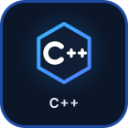

  <!-- PROFILE BANNER -->
  

  <!-- HERO SECTION -->
  

  # Krexilor

  **Systems programming · Backend development · C++** 
  Building efficient software and exploring the fundamentals of C++
  
  
  &nbsp;&nbsp;&nbsp;
  
  &nbsp;&nbsp;&nbsp;
  

  <!-- TECH STACK SECTION -->
  

  # Tech Stack

  <table align = "center" width = "100%">
    <thead>
      <tr>
        <th>Languages</th>
        <th>Development Tools</th>
        <th>Platforms &amp; Systems</th>
      </tr>
    </thead>
    <tbody>
      <tr>
        <td align = "center" valign = "top">
          
        </td>
        <td align = "center" valign = "top">
          
          
        </td>
        <td align = "center" valign = "top">
          
        </td>
      </tr>
    </tbody>
  </table>

  <!-- FEATURED PROJECTS SECTION -->
  

  # Featured Projects

  | S. No. | Project Name | Description | Tech Stack | Links |
  |:---:|:---:|:---:|:---:|:---:|
  | 1. | [Portfolio](https://github.com/Krexilor/Portfolio) | A modern, responsive portfolio website built with react | `React` `JavaScript` `Vite` | [Live Demo](https://krexilor.pages.dev) |
  | 2. | [HueForge](https://github.com/Krexilor/HueForge) | An interactive dev tool for building complete, functional color systems, not just isolated palettes | `React` `JavaScript` `Vite` | [Live Demo](https://hueforge.pages.dev) |

  <!-- GITHUB STATISTICS SECTION -->
  

  # GitHub Statistics

  
  

  <!-- GITHUB ACTIVITY SECTION -->
  

  # GitHub Activity

  

