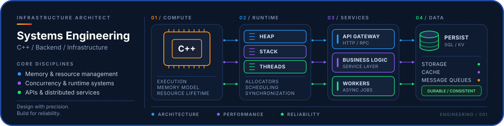
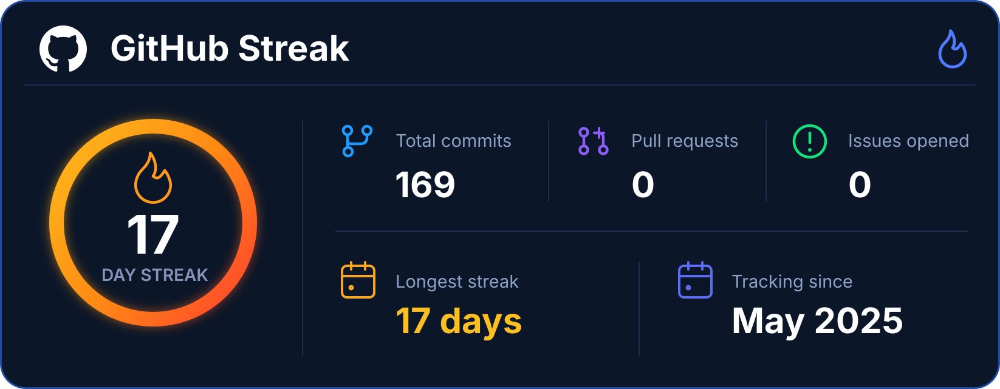
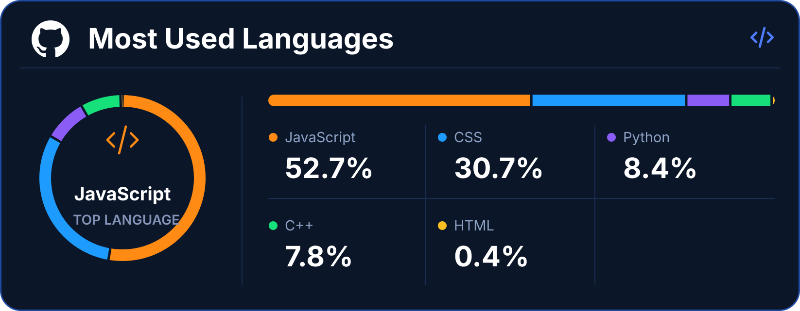

  <!-- PROFILE BANNER -->
  

  <!-- HERO SECTION -->
  

  # Krexilor

  **Systems programming · Backend development · C++** 
  Building efficient software and exploring the fundamentals of C++
  
  
  &nbsp;&nbsp;&nbsp;
  

  <!-- GITHUB STATISTICS SECTION -->
  

  # GitHub Statistics

  
  

  <!-- GITHUB ACTIVITY SECTION -->
  

  # GitHub Activity

  

